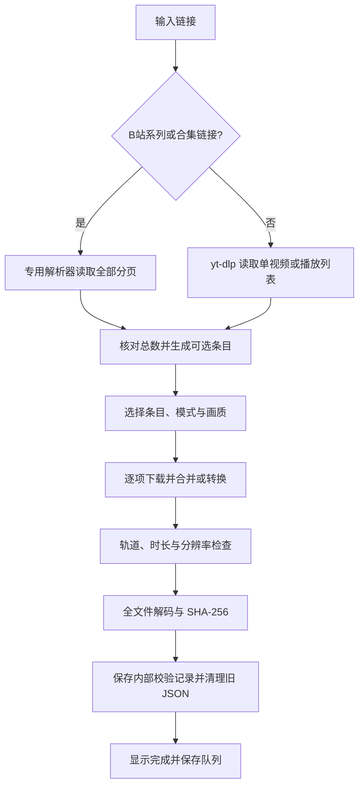

# 架构与功能流程

## 模块职责

| 位置 | 职责 |
|---|---|
| `source/BDownloader/App.xaml`、`MainWindow.xaml` | 应用入口、资源和主窗口 |
| `Views/DownloadView.xaml(.cs)` | 链接输入、条目选择、下载设置、队列恢复、进度与重新校验 |
| `Views/AccountsWindow.xaml(.cs)` | B站二维码与 YouTube 会话导入界面 |
| `Core/BilibiliPlaylistResolver.cs` | B站系列 / 合集地址识别、分页读取及完整列表确认 |
| `Core/MediaEngine.cs` | yt-dlp / FFmpeg 调用、媒体处理、完整性检查与进程取消 |
| `Services/BilibiliLogin.cs` | 二维码生成、状态轮询、Cookie 保存与退出 |
| `Services/MediaAccounts.cs` | YouTube Cookie 导入、按平台创建临时会话及清理 |
| `Services/AppPaths.cs` | 区分正在执行的运行目录与持久数据目录 |
| `source/BundleLauncher/Program.cs` | 单文件载荷验证、缓存展开、修复及 WPF 子进程启动 |

表中 `Views/`、`Core/`、`Services/` 均相对于 `source/BDownloader/`。项目使用 WPF 事件处理及服务类组织功能，当前没有独立数据库或 Web 后端。

## 解析与下载

B站列表解析器按每页 30 项请求，核对分页总数、列表编号、所属用户及去重结果。播放器链接中的 `bvid` / `oid` 指向当前播放视频，不能当作整份列表。缺页、重复、总数变化、失效条目等情况会报错，避免把部分结果当成完整列表。未明确类型且系列确实不存在时，才尝试合集命名空间；登录或风控错误不会触发这种回退。

通用解析由 `MediaEngine.InspectAsync` 调用 yt-dlp，使用 `--flat-playlist`、`--dump-single-json`、`--yes-playlist`。界面按 HTTPS 链接校验，下载引擎另检查域名及 URL 中的用户信息，避免接受伪装域名。

`DownloadAsync` 顺序处理选中的条目。每项以 `--no-playlist` 下载，保留 `.part` 以便续传，读取带前缀的进度、最终文件路径和该视频时长。支持视频含音频、仅视频、M4A、MP3，以及视频高度上限。仅视频模式另外移除音轨。

## 完整性与完成状态

下载器退出成功还不能标记完成。引擎依次确认最终文件位于目标目录、轨道符合模式、时长有效、分辨率未超过上限，然后全程解码。时长与解码终点容差取 `2 秒` 与 `预期时长 × 3%` 中较大者；源时长未知时无法做源时长差值比较，但仍检查实际时长、解码与轨道。

全解码使用 `-xerror -err_detect explode`，已明确识别的少量 AV1 信息提示可放行，其他解码错误会失败。媒体在探测、解码和摘要期间保持只读共享锁，减少检查过程中被替换的可能。SHA-256 用于建立本地基准，并不是平台提供的原始文件摘要，因此不能单独证明源站内容正确。

校验失败的新下载最终文件会重命名为 `.failed-<时间>-<随机值>` 留待检查，重试可重新获取媒体。公开重新校验不会覆盖不匹配的历史基准。v1.0.1 的校验记录存储与旧 JSON 清理规则见[数据文档](DATA.md)。

## 登录与子进程

B站登录采用二维码生成与轮询，用户在手机客户端确认；保存的是 Cookie，会话有效性仍由平台决定。YouTube 通过导入 Netscape Cookie 文件保存会话。两种持久会话均使用当前 Windows 用户的 DPAPI 加密。

yt-dlp 使用应用内固定路径的 QuickJS，参数包含 `--no-js-runtimes` 后再指定 `--js-runtimes quickjs:<路径>`；不会自动依赖外部 Deno。所有下载工具均通过 `ProcessStartInfo` 直接启动，参数按 Windows 规则转义。取消通过 Windows Job Object 与进程树终止逻辑处理下载子进程。

单文件启动器完成载荷和缓存验证后启动正常的 WPF 子进程并退出。运行时缓存版本与用户数据分离，更新 EXE 不会因缓存目录改变而切换账号和队列。
